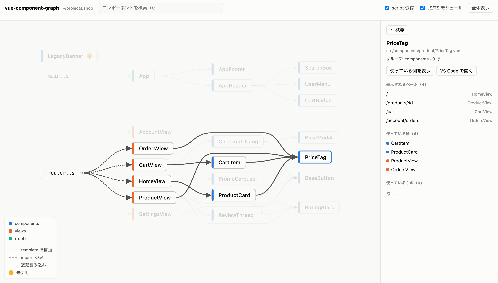
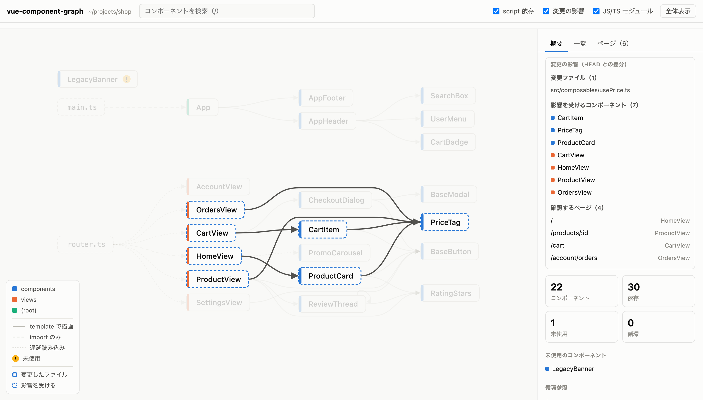

# vue-component-graph

[English](README.md) | **日本語**

Vue プロジェクトを静的解析して、**コンポーネントの依存関係**と、**それぞれがどのページに表示されるか**をインタラクティブな HTML で見せる CLI。

<picture>
  <source media="(prefers-color-scheme: dark)" srcset="docs/graph-dark.png">
  
</picture>

答えられる問い：

- この部品は、どのコンポーネントから使われていて、どの URL に表示されるか
- この PR の変更で、どのページを確認すればいいか（`--since`）
- 使われていないコンポーネントや、循環参照はあるか

## クイックスタート

Node.js 20 以上が必要。インストールせずに実行できる。

```sh
cd your-vue-app
npx vue-component-graph
```

チームで使うなら devDependencies に入れておく。

```sh
npm install -D vue-component-graph
```

解析結果の HTML がブラウザで開く。ターミナルにも要約が出る。

```
22 components, 30 edges, 6 routes

未使用 (1)
  src/components/LegacyBanner.vue
```

HTML の出力先は `node_modules/.cache/vue-component-graph/graph.html`。`node_modules` が無いときは OS の一時ディレクトリに書く。プロジェクトに未追跡ファイルは増えない。

## 変更の影響を調べる（`--since`）

```sh
npx vue-component-graph --since main
```

`main` との merge-base から今の作業ツリーまでの差分（未コミット・未追跡のファイルを含む）を起点に、import と template での使用を逆に辿る。影響を受けるコンポーネントと、確認すべきページを出す。

```
変更の影響（main との差分）
  変更ファイル (1)
    src/composables/usePrice.ts
  影響するコンポーネント (7)
    CartItem, PriceTag, ProductCard, CartView, HomeView, ProductView, OrdersView
  確認するページ (4)
    /                HomeView
    /products/:id    ProductView
    /cart            CartView
    /account/orders  OrdersView
```

<picture>
  <source media="(prefers-color-scheme: dark)" srcset="docs/impact-dark.png">
  
</picture>

- `.vue` 以外の変更も辿る（composable、ユーティリティ、`?raw` で読み込むファイルなど）
- `createApp(App)` の配下にある部品（ヘッダーなど）や、エントリが読み込むグローバル CSS が変わったときは「全ページに影響」と判定する

## AI エージェントから使う（MCP）

MCP サーバーとして起動でき、Claude Code などのエージェントがツールとして呼び出せる。grep では見つからない依存（自動 import、グローバル登録、kebab-case のタグ）や「どの URL に出るか」を、エージェントが正確に調べられる。

Claude Code の場合：

```sh
claude mcp add -s user vue-component-graph -- npx -y vue-component-graph mcp
```

ほかのクライアントでは、設定ファイルに次を書く。

```json
{
  "mcpServers": {
    "vue-component-graph": { "command": "npx", "args": ["-y", "vue-component-graph", "mcp"] }
  }
}
```

| ツール | 入力 | 返すもの |
|---|---|---|
| `component_info` | `component` | 使っている側、使っているもの、表示されるページ、外部コンポーネント |
| `who_uses` | `component` | 直接の親、祖先、エントリからの経路、表示されるページ |
| `impact` | `files` または `since` | 影響を受けるコンポーネントと、確認すべきページ |
| `routes` | なし | ルートごとの画面、親ルート、名前付きビュー、全ページ共通の部品 |
| `find_issues` | なし | 未使用、循環、再帰、解析の警告 |

- どのツールも `root`（package.json のあるディレクトリ）を受け取る。省略するとサーバーの起動ディレクトリを使う
- `impact` に `files` を渡すと「これらを変えたら」の見積もりになる。エージェントが変更する前に影響の広さを確かめられる
- すべて読み取り専用で、ファイルを書き換えない

出力の例（`who_uses`、`examples/shop` に対して）：

```
PriceTag (src/components/product/PriceTag.vue)
直接の親 (4):
  - CartItem (src/components/cart/CartItem.vue)
  - ProductCard (src/components/product/ProductCard.vue)
  - ProductView (src/views/ProductView.vue)
  - OrdersView (src/views/account/OrdersView.vue)
祖先 (6): CartView, CartItem, HomeView, ProductCard, ProductView, OrdersView
読み込むモジュール (1): src/router.ts
経路:
  src/router.ts → CartView → CartItem → PriceTag
  src/router.ts → HomeView → ProductCard → PriceTag
  src/router.ts → ProductView → PriceTag
  src/router.ts → OrdersView → PriceTag
表示されるページ (4):
  /                HomeView
  /products/:id    ProductView
  /cart            CartView
  /account/orders  OrdersView
```

## 検出できるもの

### コンポーネント間の依存

| 書き方 | 例 |
|---|---|
| 相対パス・エイリアスの import | `import Foo from './Foo.vue'`、tsconfig の `paths`、`@/` `~/` |
| template のタグ | `<FooBar>`、`<foo-bar>`、`<component :is="cond ? A : B">` |
| Options API | `components: { Foo }` |
| 遅延読み込み | `defineAsyncComponent(() => import('./Foo.vue'))` |
| グローバル登録 | `app.component('Foo', Foo)` |
| 自動 import | unplugin-vue-components / Nuxt の `components.d.ts` |
| Nuxt の components/ | `.nuxt/` が無くても Nuxt の命名規則で解決（`user/Card.vue` → `<UserCard>`、`Lazy` 付き、`#components` からの import） |
| バレル | `export { default as Foo } from './Foo.vue'` |
| 再帰 | 自分自身をファイル名で描画するコンポーネント |

template で描画せず import だけしている依存（ルート定義、`h()`、変数経由など）は「import のみ」として区別して表示する。`.vue` を import している `main.ts` や `router.ts` もノードとして出る。

### ページ（ルート）

- **vue-router**：`children` のネスト、名前付きビュー（`components: { default, side }`）、`.map()` などで作る動的ルート
- **Nuxt**：`pages/` のファイルベースルーティング（`[id]`、`[[id]]`、`[...slug]`、`(group)`）
- **全ページ共通**：`createApp(App)` の配下と、Nuxt の `app.vue` / `layouts/default.vue`

### 構造の問題

- 未使用のコンポーネント（どこからも使われていないもの）
- 循環参照
- 外部コンポーネント（ライブラリ由来で、解析対象外のもの）の使用箇所

## ビューアの操作

| 操作 | 内容 |
|---|---|
| ホバー / クリック | そのコンポーネントの祖先と子孫を強調表示する |
| 詳細パネル | 使っている側、使っているもの、表示されるページ、外部コンポーネント |
| 「配下だけ表示」「使っている側を表示」 | グラフをその範囲に絞る。概要の数字も絞った範囲で数え直す |
| 「VS Code で開く」 | ファイルをエディタで開く |
| タブ | 概要（未使用・循環など）／一覧（親・子・行数でソート）／ページ（ルートごとの画面と部品数） |
| `/` | 検索 |
| `F` | 全体を表示 |
| ドラッグ / ピンチ・Ctrl+ホイール | パン / ズーム |
| `Esc` | 選択・絞り込みを解除 |

右上の「English」/「日本語」ボタンで表示言語を切り替えられる（初期値はブラウザの言語、選んだ言語は記憶する）。ライト / ダークモードは OS の設定に従う。

## オプション

```
vue-component-graph [dir] [options]
```

| オプション | 説明 |
|---|---|
| `-o, --out <file>` | HTML の出力先 |
| `--focus <name>` | 指定コンポーネントの配下だけを表示 |
| `--who-uses <name>` | 指定コンポーネントを使っている側だけを表示 |
| `--since <ref>` | git の `ref` からの変更が影響するコンポーネントとページを出す |
| `--externals` | ライブラリ等の外部コンポーネントもノードとして表示 |
| `--json` | HTML の代わりに JSON を標準出力へ |
| `--no-open` | 生成後にブラウザで開かない |

`vue-component-graph mcp [--root <dir>]` で MCP サーバー（stdio）として起動する。

`<name>` はコンポーネント名（`AppHeader`、`app-header`）かパスの末尾（`nav/NavLink`）。複数に一致した場合は候補を表示して終了する。

## JSON 出力

`--json` は次の形を出力する。CI やほかのツールと組み合わせるときに使う。

```ts
{
  root: string
  nodes: {
    id: string            // ルートからの相対パス
    name: string
    kind: 'component' | 'module' | 'external'
    group: string         // src/ 直下のディレクトリ名
    entry: boolean        // フレームワークが直接描画する（App.vue、Nuxt の pages/ など）
    lines: number
    externals: string[]   // 使っている外部コンポーネント
    routes: number[]      // 表示されるページ（routes の添字）
    shell: boolean        // 全ページ共通
  }[]
  edges: { from: string; to: string; type: 'template' | 'script'; async: boolean }[]
  routes: {
    path: string
    dynamic: boolean      // path が式で、実際の URL は実行時に決まる
    view: string          // メインの画面
    layouts: string[]     // 親ルートの画面
    chain: string[]       // このルートで描画されるルートコンポーネントすべて
    source: string        // ルートを定義しているファイル
  }[]
  orphans: string[]
  cycles: string[][]
  recursive: string[]
  entries: string[]       // createApp() を呼んでいるモジュール
  warnings: string[]
  impact?: { since: string; changed: string[]; affected: string[]; routes: number[]; everywhere: boolean }
}
```

## 制限

静的解析なので、実行時にしか決まらないものは分からない。

- **動的なルート**：`path` が式のルート（例：`` `/x/${id}` ``）は 1 件として扱う。実際に何本の URL になるかは分からない
- **描画関数**：`h()` や JSX / TSX で描画するコンポーネントは、template の依存として検出できない（import されていれば「import のみ」として出る）
- **Vite のファイルベースルーティング**：vue-router の Vite プラグイン（旧 unplugin-vue-router）や vite-plugin-pages の `src/pages/` からはルートを作らない。ページのコンポーネント自体は解析し、未使用とは判定しない
- **生成されない `components.d.ts`**：unplugin-vue-components の自動 import は、開発サーバーが生成する `components.d.ts` を読む。リポジトリに含めていないと解決できない。Nuxt は `.nuxt/` が無くても `components/` から推定するが、`nuxt.config` で追加したディレクトリやレイヤーは `nuxi prepare` 後でないと解決できない
- **プラグイン登録**：プラグインがグローバル登録するコンポーネント（`RouterView` など）は外部コンポーネントとして扱う
- **template 言語**：pug などの template は解析しない
- **composable**：composable 自体はグラフのノードにならない（影響分析では辿る）

## 開発

```sh
npm install        # prepare で dist/ もビルドされる
npm test           # vitest
npm run typecheck
npm run demo       # examples/shop を解析して開く
npm link           # vue-component-graph コマンドとして使う
```

`examples/shop` は README のスクリーンショットに使っている架空のショップアプリ。

## ライセンス

[MIT](LICENSE)
