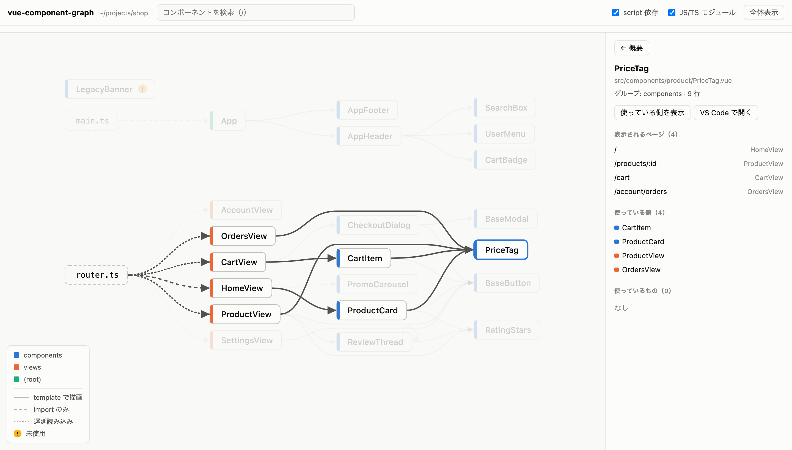
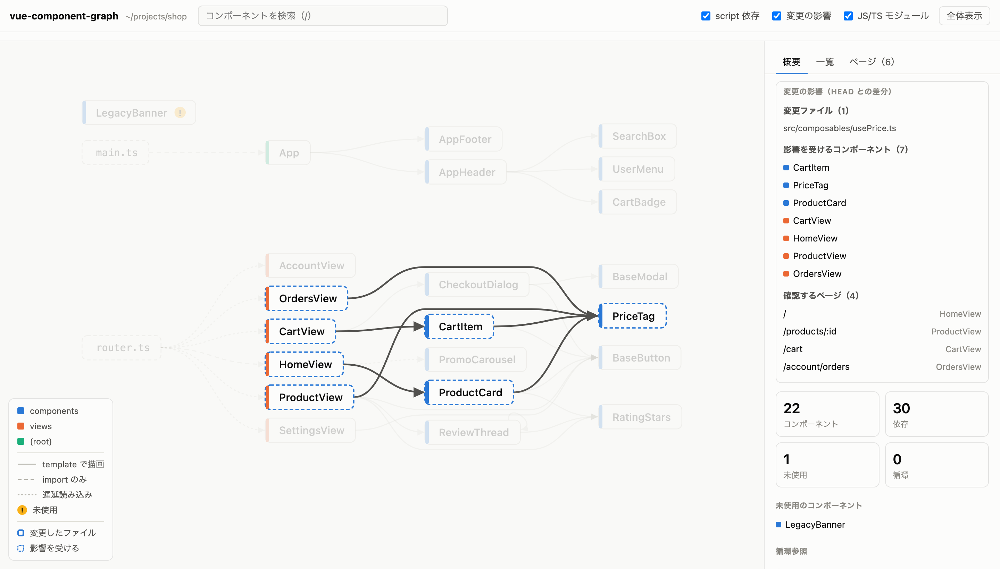

# vue-component-graph

**English** | [日本語](https://github.com/kotta-27/vue-component-graph/blob/main/README.ja.md)

A CLI that statically analyzes a Vue project and shows, as interactive HTML, **how components depend on each other** and **which pages each one appears on**.

<picture>
  <source media="(prefers-color-scheme: dark)" srcset="https://raw.githubusercontent.com/kotta-27/vue-component-graph/main/docs/graph-dark.png">
  
</picture>

Questions it answers:

- Which components use this one, and on which URLs does it show up?
- Which pages should I check for the changes in this PR? (`--since`)
- Are there unused components or circular references?

> [!NOTE]
> The viewer UI switches between English and Japanese (it follows your browser's language by default). Terminal output and MCP responses are currently in Japanese.

## Quick start

Requires Node.js 20 or later. Runs without installing:

```sh
cd your-vue-app
npx vue-component-graph
```

To share it with your team, add it to devDependencies:

```sh
npm install -D vue-component-graph
```

The analysis opens in your browser as HTML, and a summary is printed to the terminal:

```
22 components, 30 edges, 6 routes

未使用 (1)
  src/components/LegacyBanner.vue
```

The HTML is written to `node_modules/.cache/vue-component-graph/graph.html`, or to the OS temp directory when there is no `node_modules`. No untracked files are added to your project.

## Change impact (`--since`)

```sh
npx vue-component-graph --since main
```

Starting from the diff between the merge-base with `main` and the current working tree (including uncommitted and untracked files), it walks imports and template usage backwards. It lists the affected components and the pages to check.

```
変更の影響（main との差分）
  変更ファイル (1)
    src/composables/usePrice.ts
  影響するコンポーネント (7)
    CartItem, PriceTag, ProductCard, CartView, HomeView, ProductView, OrdersView
  確認するページ (4)
    /                HomeView
    /products/:id    ProductView
    /cart            CartView
    /account/orders  OrdersView
```

<picture>
  <source media="(prefers-color-scheme: dark)" srcset="https://raw.githubusercontent.com/kotta-27/vue-component-graph/main/docs/impact-dark.png">
  
</picture>

- Changes outside `.vue` files are followed too (composables, utilities, files loaded with `?raw`, and so on)
- A change to a component under `createApp(App)` (such as the header) or to global CSS loaded by the entry is reported as affecting every page

## Using it from AI agents (MCP)

It can run as an MCP server, so agents such as Claude Code can call it as a tool. Agents get accurate answers about dependencies that grep cannot find (auto-imports, global registration, kebab-case tags) and about which URLs a component appears on.

For Claude Code:

```sh
claude mcp add -s user vue-component-graph -- npx -y vue-component-graph mcp
```

For other clients, add this to the config file:

```json
{
  "mcpServers": {
    "vue-component-graph": { "command": "npx", "args": ["-y", "vue-component-graph", "mcp"] }
  }
}
```

| Tool | Input | Returns |
|---|---|---|
| `component_info` | `component` | Components that use it, components it uses, pages it appears on, external components |
| `who_uses` | `component` | Direct parents, ancestors, paths from entry points, pages it appears on |
| `impact` | `files` or `since` | Affected components and the pages to check |
| `routes` | none | Screen for each route, parent routes, named views, components shared by all pages |
| `find_issues` | none | Unused components, cycles, recursion, analysis warnings |

- Every tool accepts `root` (the directory containing package.json). If omitted, the server's working directory is used
- Passing `files` to `impact` gives a "what if I change these" estimate, so an agent can check how far a change reaches before making it
- All tools are read-only and never modify files

Example output (`who_uses` on `examples/shop`):

```
PriceTag (src/components/product/PriceTag.vue)
直接の親 (4):
  - CartItem (src/components/cart/CartItem.vue)
  - ProductCard (src/components/product/ProductCard.vue)
  - ProductView (src/views/ProductView.vue)
  - OrdersView (src/views/account/OrdersView.vue)
祖先 (6): CartView, CartItem, HomeView, ProductCard, ProductView, OrdersView
読み込むモジュール (1): src/router.ts
経路:
  src/router.ts → CartView → CartItem → PriceTag
  src/router.ts → HomeView → ProductCard → PriceTag
  src/router.ts → ProductView → PriceTag
  src/router.ts → OrdersView → PriceTag
表示されるページ (4):
  /                HomeView
  /products/:id    ProductView
  /cart            CartView
  /account/orders  OrdersView
```

## What it detects

### Dependencies between components

| Pattern | Example |
|---|---|
| Relative and aliased imports | `import Foo from './Foo.vue'`, tsconfig `paths`, `@/` `~/` |
| Template tags | `<FooBar>`, `<foo-bar>`, `<component :is="cond ? A : B">` |
| Options API | `components: { Foo }` |
| Lazy loading | `defineAsyncComponent(() => import('./Foo.vue'))` |
| Global registration | `app.component('Foo', Foo)` |
| Auto-imports | `components.d.ts` from unplugin-vue-components / Nuxt |
| Nuxt `components/` | Resolved with Nuxt's naming rules even without `.nuxt/` (`user/Card.vue` → `<UserCard>`, `Lazy` prefix, imports from `#components`) |
| Barrels | `export { default as Foo } from './Foo.vue'` |
| Recursion | A component that renders itself by its file name |

Dependencies that are imported but not rendered in the template (route definitions, `h()`, via variables, and so on) are shown separately as "import only". Modules such as `main.ts` and `router.ts` that import `.vue` files also appear as nodes.

### Pages (routes)

- **vue-router**: nested `children`, named views (`components: { default, side }`), dynamic routes built with `.map()` and the like
- **Nuxt**: file-based routing in `pages/` (`[id]`, `[[id]]`, `[...slug]`, `(group)`)
- **Shared by all pages**: everything under `createApp(App)`, and Nuxt's `app.vue` / `layouts/default.vue`

### Structural issues

- Unused components (not used from anywhere)
- Circular references
- Where external components (from libraries, outside the analysis) are used

## Viewer controls

| Action | What it does |
|---|---|
| Hover / click | Highlights the component's ancestors and descendants |
| Details panel | Components that use it, components it uses, pages it appears on, external components |
| "Show descendants only" / "Show users" | Narrows the graph to that scope. Summary counts are recalculated for the narrowed scope |
| "Open in VS Code" | Opens the file in your editor |
| Tabs | Overview (unused, cycles, …) / List (sortable by parents, children, lines) / Pages (screen and component count per route) |
| `/` | Search |
| `F` | Fit the whole graph |
| Drag / pinch or Ctrl+wheel | Pan / zoom |
| `Esc` | Clear selection and filters |

The "日本語" / "English" button switches the language, and the choice is remembered. Light and dark mode follow your OS setting.

## Options

```
vue-component-graph [dir] [options]
```

| Option | Description |
|---|---|
| `-o, --out <file>` | Where to write the HTML |
| `--focus <name>` | Show only the given component and its descendants |
| `--who-uses <name>` | Show only the components that use the given component |
| `--since <ref>` | Show components and pages affected by changes since the git `ref` |
| `--externals` | Also show external components (from libraries) as nodes |
| `--json` | Print JSON to stdout instead of writing HTML |
| `--no-open` | Don't open the browser after generating |

`vue-component-graph mcp [--root <dir>]` starts the MCP server (stdio).

`<name>` is a component name (`AppHeader`, `app-header`) or the end of a path (`nav/NavLink`). If several components match, the candidates are printed and the command exits.

## JSON output

`--json` prints the following shape. Use it with CI or other tools.

```ts
{
  root: string
  nodes: {
    id: string            // path relative to root
    name: string
    kind: 'component' | 'module' | 'external'
    group: string         // directory directly under src/
    entry: boolean        // rendered directly by the framework (App.vue, Nuxt pages/, …)
    lines: number
    externals: string[]   // external components it uses
    routes: number[]      // pages it appears on (indices into routes)
    shell: boolean        // shared by all pages
  }[]
  edges: { from: string; to: string; type: 'template' | 'script'; async: boolean }[]
  routes: {
    path: string
    dynamic: boolean      // path is an expression; the real URL is decided at runtime
    view: string          // main screen
    layouts: string[]     // screens of parent routes
    chain: string[]       // every route component rendered for this route
    source: string        // file that defines the route
  }[]
  orphans: string[]
  cycles: string[][]
  recursive: string[]
  entries: string[]       // modules that call createApp()
  warnings: string[]
  impact?: { since: string; changed: string[]; affected: string[]; routes: number[]; everywhere: boolean }
}
```

## Limitations

This is static analysis, so anything decided only at runtime is unknown.

- **Dynamic routes**: a route whose `path` is an expression (e.g. `` `/x/${id}` ``) counts as one route. How many real URLs it produces is unknown
- **Render functions**: components rendered with `h()` or JSX / TSX are not detected as template dependencies (if imported, they show up as "import only")
- **File-based routing in Vite**: no routes are built from `src/pages/` for vue-router's Vite plugin (formerly unplugin-vue-router) or vite-plugin-pages. The page components themselves are still analyzed and are not reported as unused
- **`components.d.ts` not committed**: auto-imports from unplugin-vue-components are read from the `components.d.ts` the dev server generates; if it isn't in the repository they can't be resolved. Nuxt is inferred from `components/` even without `.nuxt/`, but directories added in `nuxt.config` and layers are resolved only after `nuxi prepare`
- **Plugin registration**: components registered globally by plugins (`RouterView`, …) are treated as external components
- **Template languages**: templates in pug and the like are not analyzed
- **Composables**: composables are not nodes in the graph (impact analysis does follow them)

## Development

```sh
npm install        # prepare also builds dist/
npm test           # vitest
npm run typecheck
npm run demo       # analyze examples/shop and open it
npm link           # use it as the vue-component-graph command
```

`examples/shop` is a fictional shop app used for the README screenshots.

## License

[MIT](LICENSE)
